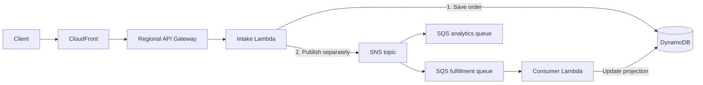
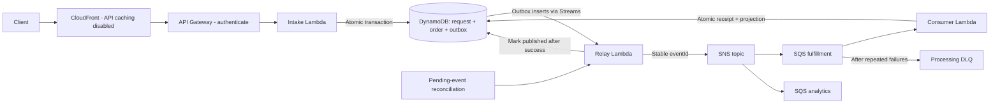

# Reliable order intake under retries

**An AWS architecture case study by Anqi Chen**  
CloudFront · API Gateway · Lambda · DynamoDB · SNS · SQS

> **Scope:** An illustrative design exercise with an executable local failure model. This is not an employer incident, an AWS deployment, or a production benchmark. I designed the change and implemented the model in this repository.

**The decision:** Save an order and its pending event together, then make repeated delivery safe for the consumer's database update.

[Run the evidence](#5-evidence) · [Deployment considerations](docs/aws-design.md) · [Portfolio](https://onlyanqi.github.io/portfolio/)

## 1. Problem

Imagine a small shop accepting orders during a product launch. A customer retries after a timeout. An order exists in the database, but fulfillment never hears about it. Another order is processed twice after a worker's acknowledgement is lost.

These are two different failure boundaries: **saving state versus publishing an event**, and **processing an event versus acknowledging it**. More retries alone do not fix either boundary.

For this exercise, success means:

- An accepted order has a durable event waiting to be published.
- Retrying the same tenant-scoped request returns the same order; changing its payload is rejected.
- Repeated delivery of an event does not repeat the fulfillment database update.
- A failed record can be retried without forcing successful records in its batch to run again.

Assumptions: one AWS Region, independently processed orders, eventual fulfillment, and two downstream needs—fulfillment and analytics. Payments and inventory reservation are outside this example. No global ordering requirement is assumed.

## 2. Current design



CloudFront is the existing edge entry point. API Gateway authenticates requests and routes them to Lambda. DynamoDB stores orders. SNS separates publishers from independent subscribers; each SQS queue buffers work for its consumer. Only the fulfillment consumer is modeled here.

**Failure A:** Intake commits to DynamoDB, then stops before publishing to SNS. The order exists without a notification. A database transaction cannot include an SNS publish.

**Failure B:** A consumer commits its update, then fails before its queue acknowledgement. Redelivery repeats the update unless the consumer recognizes the event. A whole-batch failure also retries healthy records. [AWS describes the SQS retry and partial-batch behavior here.](https://docs.aws.amazon.com/lambda/latest/dg/services-sqs-errorhandling.html)

## 3. Options considered

| Option | What it helps | Why I chose or rejected it |
| --- | --- | --- |
| Keep fulfillment synchronous | Simple request flow and immediate feedback | Couples checkout availability and latency to downstream work; still needs request idempotency. |
| Add retries to the existing SNS publish | Recovers transient publishing errors while intake is alive | A process can stop after the database commit; there is no durable record of unfinished publishing. |
| Use SNS/SQS FIFO | Useful when ordering within a group is a requirement | Does not make the database write and publish atomic, or replace idempotency around external effects. Ordering is not needed for these independent orders. |
| Transactional outbox + idempotent consumer | Makes publishing intent durable; handles duplicate delivery | **Chosen.** Adds relay, reconciliation, storage, and operational responsibility, but directly addresses both failure boundaries. |

SNS is justified by the two independent subscribers. With only one consumer, I would consider publishing the outbox directly to SQS and remove SNS. The outbox is an established pattern, not a new invention; my work is applying it to these boundaries and testing the failure cases. [AWS transactional outbox guidance.](https://docs.aws.amazon.com/prescriptive-guidance/latest/cloud-design-patterns/transactional-outbox.html)

## 4. My change



### Accept once, remember the intent

In the proposed AWS implementation, intake uses `TransactWriteItems` to save three items together: a request record, an order, and a pending outbox event. The request key includes the authenticated tenant and the client's idempotency key. It stores a canonical payload fingerprint and the original order ID. A matching retry returns that ID; different content with the same key returns a conflict. A conditional write prevents competing requests from both winning. [DynamoDB transaction semantics.](https://docs.aws.amazon.com/amazondynamodb/latest/developerguide/transaction-apis.html)

The API returns **202 Accepted after the transaction commits**. This means the order is accepted for processing, not that fulfillment is complete. A status endpoint reads its progress. Neither HTTP endpoint is implemented in the local model.

### Publish at least once

An outbox-insert stream record triggers the relay. The relay publishes the stored event ID and only then marks the event sent. A crash between those steps can publish twice. A pending-event reconciliation job retries events the stream path did not finish. Pending items remain durable until handled; they do not expire with the stream.

### Apply the database effect once per event

The consumer writes a receipt keyed by `(consumer, eventId)` and updates its projection in one transaction. If the receipt already exists, it skips that event. If the update fails, the receipt rolls back too. This protects the modeled database effect while receipts are retained; it is **not an end-to-end exactly-once guarantee**, particularly for payments, emails, or other external calls.

For mixed SQS batches, enable `ReportBatchItemFailures` and return failed **SQS message IDs**, not application event IDs. Healthy records can complete independently. A processing DLQ makes repeated failures visible and available for controlled replay.

### Keep the edge and operational boundaries explicit

For authenticated API traffic, disable CloudFront caching and forward authorization to API Gateway. `AllViewerExceptHostHeader` is an origin request policy intended for API Gateway origins; it is separate from the cache policy. API authorization is still required even if someone bypasses CloudFront. [CloudFront policy documentation.](https://docs.aws.amazon.com/AmazonCloudFront/latest/DeveloperGuide/using-managed-origin-request-policies.html)

The [AWS design notes](docs/aws-design.md) cover item keys, queue settings, retention, replay, permissions, and a proposed rollout. They are design guidance, not deployable infrastructure.

## 5. Evidence

**Observed locally: 10 tests passed.** The [checked-in report](evidence/run.json) is generated by the test runner; [GitHub Actions](https://github.com/onlyanqi/aws-event-driven-case-study/actions) reruns it on pushes and pull requests. Python's standard library is sufficient:

```sh
git clone https://github.com/onlyanqi/aws-event-driven-case-study.git
cd aws-event-driven-case-study
python3 scripts/evidence.py
```

| Experiment | Assertion verified by the local model |
| --- | --- |
| Baseline crash after save, before publish | 1 order exists; 0 events published—reproduces the gap. |
| Intake failure before outbox write | 0 orders, request records, or outbox events remain. |
| Retry matching request | Same order ID; 1 outbox event. |
| Reuse key with changed payload | Conflict; original order remains the only order. |
| Same client key, different tenants | 2 distinct orders. |
| Publish fails before delivery | Event remains pending; retry publishes it. |
| Relay crashes after publish, before marking sent | 2 deliveries with the same event ID; 1 database effect. |
| Consumer stops between receipt and effect | Both roll back; subsequent attempt succeeds. |
| Consumer acknowledgement is lost after commit | Redelivery is recognized; 1 database effect. |
| One record in a two-record batch fails | Only that message ID is returned; retry completes the second effect. |

[Implementation](model.py) · [Assertions](tests/test_model.py)

**What this evidence establishes:** the intended transaction boundaries and retry decisions work in a sequential SQLite model with injected exceptions. SQLite provides a convenient real transaction mechanism; it does not emulate DynamoDB. The in-memory publication list does not emulate SNS or SQS.

**What remains unverified:** concurrent workers, actual Lambda event-source mappings, stream recovery, DLQ routing, IAM, tenant authentication, AWS throttling, latency, throughput, and cost. No production improvement percentage or AWS availability claim is inferred from these tests.

## 6. What I would improve next

1. **Deploy an isolated AWS integration environment.** Use infrastructure as code; implement real handlers and exercise failures at the same boundaries. Verify event-source mappings, queue policies, stream filtering, and partial-batch responses.
2. **Test concurrency and replay windows.** Race identical requests and duplicate consumers; verify conditional transactions and conflict retries. Demonstrate recovery after a relay outage longer than stream retention. DynamoDB Streams retains records for 24 hours, so reconciliation cannot rely on the stream alone. [Streams documentation.](https://docs.aws.amazon.com/amazondynamodb/latest/developerguide/Streams.html)
3. **Measure before claiming improvement.** Record acceptance p95/p99, oldest pending outbox age, accepted-to-projected delay, queue age, duplicate suppression, DLQ arrivals, and cost per accepted order. Establish targets with workload and business requirements first.
4. **Harden the event contract.** Validate schema and version; minimize personal data; add trace IDs and structured logs. For future ordered updates, use aggregate versions and reject stale transitions.
5. **Design external effects explicitly.** A payment provider needs its own idempotency key and reconciliation. A local receipt cannot atomically cover a remote charge.

The engineering story I want this case study to show: identify the exact failure boundary, compare alternatives, choose a limited guarantee, and make the claim testable.
